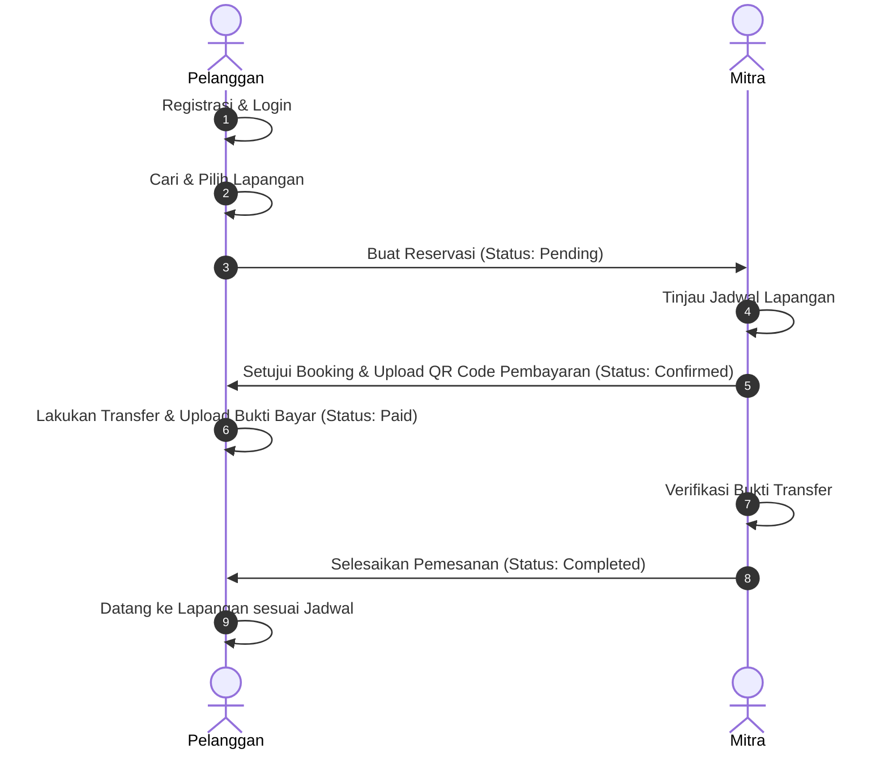

#  Courty - Sistem Reservasi Lapangan Olahraga Online

**Courty** adalah aplikasi berbasis web yang dirancang untuk memudahkan pencarian dan reservasi lapangan olahraga secara online. Sistem ini menghubungkan **Pelanggan** yang ingin menyewa lapangan olahraga dengan **Mitra** (pemilik atau pengelola GOR/sarana olahraga). 

Aplikasi ini dibangun menggunakan **PHP CodeIgniter 3** dengan basis data **MySQL/MariaDB** dan dipercantik menggunakan **Tailwind CSS** (via CDN) sehingga responsif dan modern.

---

##  Fitur Utama

Sistem Courty dibagi menjadi 3 hak akses utama (Role):

### 1. Sisi Pelanggan (Role `0`)
* **Registrasi & Login Mudah**: Pembuatan akun cepat dengan enkripsi password menggunakan `password_hash()`.
* **Cari Lapangan Olahraga**: Fitur pencarian cerdas berdasarkan nama venue, alamat, atau jenis olahraga.
* **Filter Olahraga Populer**: Kategori olahraga terpadu (Futsal, Badminton, Renang, Tennis, Padel, Basket, Voli).
* **Trending & Rekomendasi Venue**: Menampilkan venue paling populer berdasarkan jumlah dilihat (view tracking).
* **Detail Venue Lengkap**: Informasi jam operasional, alamat terintegrasi Google Maps, galeri foto lapangan, deskripsi, dan daftar harga sewa per jam.
* **Reservasi Instan**: Formulir pemesanan dengan perhitungan total harga otomatis berdasarkan durasi jam sewa.
* **Riwayat Pesanan (Pesanan Saya)**: Halaman pelacakan status booking dari *Pending*, *Confirmed*, *Paid*, hingga *Completed*.
* **Unggah Bukti Pembayaran**: Sistem unggah bukti transfer pembayaran (gambar/PDF) untuk verifikasi.

### 2. Sisi Mitra / Pemilik Venue (Role `3`)
* **Registrasi Mitra 2 Langkah (Two-Step Register)**:
  * **Langkah 1**: Registrasi data diri & akun personal.
  * **Langkah 2**: Registrasi profil venue (Nama venue, alamat, link Google Maps, deskripsi, jam operasional, dan foto profil venue).
* **Dashboard Mitra**: Panel khusus untuk melihat daftar lapangan olahraga yang dimiliki.
* **Manajemen Lapangan (CRUD)**:
  * Menambahkan lapangan baru beserta foto lapangan, deskripsi, jenis olahraga, dan tarif per jam.
  * Mengubah informasi lapangan.
  * Menghapus lapangan yang tidak aktif.
* **Manajemen Order Masuk**:
  * **Approve Booking**: Menyetujui reservasi dan mengunggah **QR Code** pembayaran agar pelanggan bisa membayar.
  * **Reject Booking**: Menolak pesanan masuk dengan menyertakan alasan penolakan tertentu.
  * **Verify Pembayaran**: Memvalidasi bukti transfer yang diunggah pelanggan untuk menyelesaikan transaksi (*Completed*).

### 3. Sisi Super Admin (Role `1`)
* **Dashboard Admin**: Panel administratif untuk monitoring pengguna sistem, venue, dan data olahraga secara global.

---

## Teknologi yang Digunakan

* **Core Framework**: PHP CodeIgniter 3.x
* **Database**: MySQL / MariaDB
* **Styling & CSS**: Tailwind CSS (via CDN)
* **Icons**: FontAwesome v6
* **Typography**: Inter (Google Fonts)

---

## Struktur Proyek

Struktur folder utama aplikasi ini mengikuti arsitektur MVC (Model-View-Controller) bawaan CodeIgniter:

```text
Courty/
├── application/
│   ├── config/            # Konfigurasi aplikasi (database, routes, autoload, dll.)
│   ├── controllers/       # Logika bisnis & navigasi utama
│   │   ├── Admin.php      # Controller panel Super Admin
│   │   ├── App.php        # Controller untuk Pelanggan (Home, Search, Details)
│   │   ├── Auth.php       # Controller untuk Autentikasi (Login, Register, Logout)
│   │   ├── Booking.php    # Controller transaksi penyewaan & pembayaran
│   │   └── Mitra.php      # Controller panel Mitra & Manajemen Lapangan
│   ├── models/            # Interaksi database
│   │   ├── model.php      # Query utama untuk users, venue, court, dan booking
│   │   └── sportModel.php # Query khusus kategori olahraga & dummy data fallback
│   └── views/             # File antarmuka / UI (.php templates)
├── assets/                # File statis (CSS, JS, Uploads)
│   └── uploads/           # Direktori penyimpanan media (file upload)
│       ├── court_profiles/# Foto-foto lapangan olahraga
│       ├── payments/      # Bukti transfer pembayaran dari pelanggan
│       ├── qrcodes/       # QR Code pembayaran yang diunggah mitra
│       └── venue_profiles/# Foto profil venue olahraga
├── courty.sql             # SQL Database dump
└── index.php              # Entry point utama aplikasi
```

---

## Skema Database (`courty`)

Aplikasi ini menggunakan 6 tabel utama yang saling berelasi:

1. **`users`**: Menyimpan data akun pengguna (Pelanggan, Mitra, Admin).
2. **`venue`**: Menyimpan data profil gedung/tempat olahraga yang didaftarkan oleh Mitra.
3. **`court`**: Menyimpan data detail lapangan di dalam suatu venue.
4. **`sport`**: Menyimpan daftar jenis olahraga yang didukung.
5. **`booking`**: Menyimpan data transaksi reservasi lapangan, bukti bayar, QR Code, dan status pembayaran.
6. **`photo`**: Menyimpan foto galeri tambahan untuk lapangan.

### Relasi Antar Tabel:
* Satu **User** (Mitra) memiliki satu **Venue** (`users.id_user` -> `venue.id_user`).
* Satu **Venue** dapat memiliki banyak **Court** (`venue.id_venue` -> `court.id_venue`).
* Setiap **Court** mengacu pada satu kategori **Sport** (`sport.id_sport` -> `court.id_sport`).
* Transaksi **Booking** mencatat relasi antara **User** (Pelanggan) dan **Court** yang disewa.

---

## Panduan Instalasi di Localhost

Ikuti langkah-langkah di bawah ini untuk menjalankan proyek ini di komputer Anda menggunakan XAMPP:

### 1. Prasyarat
Pastikan Anda sudah menginstal aplikasi berikut:
* **XAMPP** (disarankan dengan PHP 7.4 s.d. 8.0)
* Web Browser (Chrome, Edge, Firefox, dll.)

### 2. Langkah-Langkah Setup
1. **Salin Proyek**:
   Pindahkan folder `Courty` ke dalam direktori server lokal Anda:
   * Windows: `C:\xampp\htdocs\Courty`
   * Linux: `/opt/lampp/htdocs/Courty`
   
2. **Import Database**:
   * Jalankan **Apache** dan **MySQL** di XAMPP Control Panel.
   * Buka browser dan pergi ke halaman [http://localhost/phpmyadmin](http://localhost/phpmyadmin).
   * Buat database baru dengan nama `courty`.
   * Pilih database `courty`, pergi ke tab **Import**, klik **Choose File**, pilih file `courty.sql` di root proyek ini, lalu klik **Go** / **Import**.

3. **Konfigurasi Database**:
   Buka file `application/config/database.php` menggunakan text editor, sesuaikan pengaturan kredensial database Anda (default bawaan XAMPP biasanya seperti di bawah ini):
   ```php
   $db['default'] = array(
       'dsn'	   => '',
       'hostname' => 'localhost',
       'username' => 'root',
       'password' => '',
       'database' => 'courty',
       'dbdriver' => 'mysqli',
       // ... konfigurasi lainnya
   );
   ```

4. **Konfigurasi Base URL**:
   Buka file `application/config/config.php` lalu sesuaikan `base_url` proyek Anda:
   ```php
   $config['base_url'] = 'http://localhost/CodeIgniter3/Courty/'; // Sesuaikan dengan path folder Anda di htdocs
   ```

5. **Jalankan Aplikasi**:
   Buka browser Anda dan akses aplikasi melalui alamat base URL yang dikonfigurasi di atas, contoh:
   ```text
   http://localhost/CodeIgniter3/Courty/
   ```

---

## Akun Demo (Bawaan Database)

Anda dapat menggunakan akun-akun demo berikut yang sudah ada dalam database untuk menguji fitur aplikasi:

| Peran (Role) | Email | Password | Keterangan |
|---|---|---|---|
| **Super Admin** | `admin@gmail.com` | `admin123` / Silakan Daftar Baru | Hak akses mengelola sistem keseluruhan |
| **Mitra (Partner)** | `alif@gmail.com` | Silakan Daftar Baru | Mengelola "GOR Bulan Sabit" |
| **Mitra (Partner)** | `mahdi@gmail.com` | Silakan Daftar Baru | Mengelola "GOR YU AI" |
| **Pelanggan (User)** | `furinaaaaaa@gmail.com` | Silakan Daftar Baru | Melakukan booking lapangan |

> **Catatan Keamanan**: 
> Untuk keamanan data dan pengujian fitur pendaftaran secara real, disarankan untuk melakukan registrasi akun baru (baik Pelanggan maupun Mitra) secara langsung melalui antarmuka web.

---

## Alur Kerja Reservasi Lapangan



---
