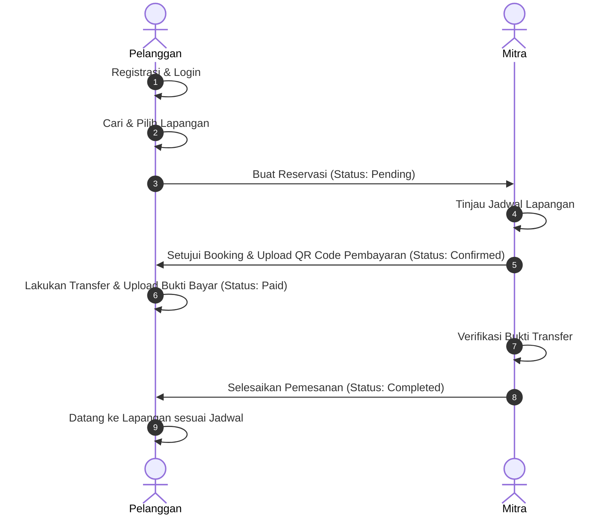

#  Courty - Sistem Reservasi Lapangan Olahraga Online

**Courty** adalah aplikasi berbasis web yang dirancang untuk memudahkan pencarian dan reservasi lapangan olahraga secara online. Sistem ini menghubungkan **Pelanggan** yang ingin menyewa lapangan olahraga dengan **Mitra** (pemilik atau pengelola GOR/sarana olahraga). 

Aplikasi ini dibangun menggunakan **PHP CodeIgniter 3** dengan basis data **MySQL/MariaDB** dan dipercantik menggunakan **Tailwind CSS** (via CDN) sehingga responsif dan modern.

---

##  Fitur Utama

Sistem Courty dibagi menjadi 3 hak akses utama (Role):

### 1. Sisi Pelanggan (Role `0`)
* **Registrasi & Login Mudah**: Pembuatan akun cepat dengan enkripsi password menggunakan `password_hash()`.
* **Cari Lapangan Olahraga**: Fitur pencarian cerdas berdasarkan nama venue, alamat, atau jenis olahraga.
* **Filter Olahraga Populer**: Kategori olahraga terpadu (Futsal, Badminton, Renang, Tennis, Padel, Basket, Voli).
* **Trending & Rekomendasi Venue**: Menampilkan venue paling populer berdasarkan jumlah dilihat (view tracking).
* **Detail Venue Lengkap**: Informasi jam operasional, alamat terintegrasi Google Maps, galeri foto lapangan, deskripsi, dan daftar harga sewa per jam.
* **Reservasi Instan**: Formulir pemesanan dengan perhitungan total harga otomatis berdasarkan durasi jam sewa.
* **Riwayat Pesanan (Pesanan Saya)**: Halaman pelacakan status booking dari *Pending*, *Confirmed*, *Paid*, hingga *Completed*.
* **Unggah Bukti Pembayaran**: Sistem unggah bukti transfer pembayaran (gambar/PDF) untuk verifikasi.

### 2. Sisi Mitra / Pemilik Venue (Role `3`)
* **Registrasi Mitra 2 Langkah (Two-Step Register)**:
  * **Langkah 1**: Registrasi data diri & akun personal.
  * **Langkah 2**: Registrasi profil venue (Nama venue, alamat, link Google Maps, deskripsi, jam operasional, dan foto profil venue).
* **Dashboard Mitra**: Panel khusus untuk melihat daftar lapangan olahraga yang dimiliki.
* **Manajemen Lapangan (CRUD)**:
  * Menambahkan lapangan baru beserta foto lapangan, deskripsi, jenis olahraga, dan tarif per jam.
  * Mengubah informasi lapangan.
  * Menghapus lapangan yang tidak aktif.
* **Manajemen Order Masuk**:
  * **Approve Booking**: Menyetujui reservasi dan mengunggah **QR Code** pembayaran agar pelanggan bisa membayar.
  * **Reject Booking**: Menolak pesanan masuk dengan menyertakan alasan penolakan tertentu.
  * **Verify Pembayaran**: Memvalidasi bukti transfer yang diunggah pelanggan untuk menyelesaikan transaksi (*Completed*).

### 3. Sisi Super Admin (Role `1`)
* **Dashboard Admin**: Panel administratif untuk monitoring pengguna sistem, venue, dan data olahraga secara global.

---

## Teknologi yang Digunakan

* **Core Framework**: PHP CodeIgniter 3.x
* **Database**: MySQL / MariaDB
* **Styling & CSS**: Tailwind CSS (via CDN)
* **Icons**: FontAwesome v6
* **Typography**: Inter (Google Fonts)

---

## Struktur Proyek

Struktur folder utama aplikasi ini mengikuti arsitektur MVC (Model-View-Controller) bawaan CodeIgniter:

```text
Courty/
├── application/
│   ├── config/            # Konfigurasi aplikasi (database, routes, autoload, dll.)
│   ├── controllers/       # Logika bisnis & navigasi utama
│   │   ├── Admin.php      # Controller panel Super Admin
│   │   ├── App.php        # Controller untuk Pelanggan (Home, Search, Details)
│   │   ├── Auth.php       # Controller untuk Autentikasi (Login, Register, Logout)
│   │   ├── Booking.php    # Controller transaksi penyewaan & pembayaran
│   │   └── Mitra.php      # Controller panel Mitra & Manajemen Lapangan
│   ├── models/            # Interaksi database
│   │   ├── model.php      # Query utama untuk users, venue, court, dan booking
│   │   └── sportModel.php # Query khusus kategori olahraga & dummy data fallback
│   └── views/             # File antarmuka / UI (.php templates)
├── assets/                # File statis (CSS, JS, Uploads)
│   └── uploads/           # Direktori penyimpanan media (file upload)
│       ├── court_profiles/# Foto-foto lapangan olahraga
│       ├── payments/      # Bukti transfer pembayaran dari pelanggan
│       ├── qrcodes/       # QR Code pembayaran yang diunggah mitra
│       └── venue_profiles/# Foto profil venue olahraga
├── courty.sql             # SQL Database dump
└── index.php              # Entry point utama aplikasi
```

---

## Skema Database (`courty`)

Aplikasi ini menggunakan 6 tabel utama yang saling berelasi:

1. **`users`**: Menyimpan data akun pengguna (Pelanggan, Mitra, Admin).
2. **`venue`**: Menyimpan data profil gedung/tempat olahraga yang didaftarkan oleh Mitra.
3. **`court`**: Menyimpan data detail lapangan di dalam suatu venue.
4. **`sport`**: Menyimpan daftar jenis olahraga yang didukung.
5. **`booking`**: Menyimpan data transaksi reservasi lapangan, bukti bayar, QR Code, dan status pembayaran.
6. **`photo`**: Menyimpan foto galeri tambahan untuk lapangan.

### Relasi Antar Tabel:
* Satu **User** (Mitra) memiliki satu **Venue** (`users.id_user` -> `venue.id_user`).
* Satu **Venue** dapat memiliki banyak **Court** (`venue.id_venue` -> `court.id_venue`).
* Setiap **Court** mengacu pada satu kategori **Sport** (`sport.id_sport` -> `court.id_sport`).
* Transaksi **Booking** mencatat relasi antara **User** (Pelanggan) dan **Court** yang disewa.

---

## Panduan Instalasi di Localhost

Ikuti langkah-langkah di bawah ini untuk menjalankan proyek ini di komputer Anda menggunakan XAMPP:

## 🐳 Panduan Menjalankan dengan Docker & Docker Compose (Rekomendasi)

Aplikasi Courty beserta database MySQL telah ter-dockerisasi penuh menggunakan Docker Compose. Database akan langsung terisi data awal secara otomatis saat pertama kali dijalankan.

### 1. Prasyarat
* [Docker Desktop](https://www.docker.com/products/docker-desktop/) (versi 20.10+ dengan Docker Compose v2) sudah terinstal dan berjalan di komputer Anda.

### 2. Setup Environment Variables
Salin berkas template `.env.example` menjadi `.env`:
* **Windows (PowerShell / CMD)**:
  ```powershell
  copy .env.example .env
  ```
* **Linux / macOS**:
  ```bash
  cp .env.example .env
  ```

Konfigurasi default di dalam `.env`:
```env
APP_PORT=8080
DB_HOST=db
DB_PORT=3306
DB_NAME=courty
DB_USER=courty_user
DB_PASSWORD=courty_password
MYSQL_ROOT_PASSWORD=root_password
```

### 3. Build & Menjalankan Service
Jalankan perintah berikut di terminal root proyek:
```bash
docker compose up --build -d
```
> Perintah di atas akan membangun image backend dari `Dockerfile`, mengunduh image `mysql:8.0`, membuat jaringan `courty_network`, membuat volume `courty_db_data`, dan mengimpor skema awal dari `courty.sql`.

Setelah proses selesai, buka browser Anda di:
👉 **[http://localhost:8080](http://localhost:8080)**

Untuk mematikan container:
```bash
docker compose down
```

---

## 🧪 Panduan Pengujian Sistem & Persistensi Data

### 1. Pengujian Endpoint / Fitur Aplikasi (Baca & Tulis Data)
1. **Buka Aplikasi**: Akses `http://localhost:8080` di browser.
2. **Uji Tulis Data (Registrasi Akun Baru)**:
   * Klik tombol **Login / Register** di pojok kanan atas, lalu pilih **Daftar Sekarang**.
   * Isi nama, email, nomor telepon, dan password baru.
   * Klik **Daftar**. Sistem akan menyimpan user baru ke tabel `users` di MySQL.
3. **Uji Baca Data (Login)**:
   * Masukkan email dan password akun yang baru didaftarkan.
   * Jika berhasil masuk dan nama Anda muncul di navbar, integrasi backend dan database terbukti sukses.

### 2. Pengujian Persistensi Data (Volume Persistence Test)
Pengujian ini membuktikan bahwa data di database tetap aman dan tidak hilang saat container dihapus/dibuat ulang:
1. Pastikan Anda sudah membuat akun baru pada langkah sebelumnya.
2. Hentikan dan hapus container di terminal (tanpa menghapus volume):
   ```bash
   docker compose down
   ```
3. Nyalakan kembali container:
   ```bash
   docker compose up -d
   ```
4. Buka kembali `http://localhost:8080`, lakukan login dengan akun yang Anda buat tadi.
5. **Hasil**: Akun tetap dapat login dengan normal, membuktikan data tersimpan permanen di dalam Docker named volume `courty_db_data`.

---

## 💻 Panduan Menjalankan Manual (Alternatif Non-Docker / XAMPP)

## Akun Demo (Bawaan Database)

Anda dapat menggunakan akun-akun demo berikut yang sudah ada dalam database untuk menguji fitur aplikasi:

| Peran (Role) | Email | Password | Keterangan |
|---|---|---|---|
| **Super Admin** | `admin@gmail.com` | `admin123` / Silakan Daftar Baru | Hak akses mengelola sistem keseluruhan |
| **Mitra (Partner)** | `alif@gmail.com` | Silakan Daftar Baru | Mengelola "GOR Bulan Sabit" |
| **Mitra (Partner)** | `mahdi@gmail.com` | Silakan Daftar Baru | Mengelola "GOR YU AI" |
| **Pelanggan (User)** | `furinaaaaaa@gmail.com` | Silakan Daftar Baru | Melakukan booking lapangan |

> **Catatan Keamanan**: 
> Untuk keamanan data dan pengujian fitur pendaftaran secara real, disarankan untuk melakukan registrasi akun baru (baik Pelanggan maupun Mitra) secara langsung melalui antarmuka web.

---

## Alur Kerja Reservasi Lapangan



---

## 📚 Referensi & Penggunaan AI (Attribution)
* **Framework**: CodeIgniter 3.1.13 Documentation ([codeigniter.com](https://codeigniter.com))
* **Containerization**: Official Docker & Docker Compose Documentation ([docs.docker.com](https://docs.docker.com))
* **Bantuan AI**: Menggunakan asistensi AI (Antigravity AI Assistant) untuk perancangan `Dockerfile`, konfigurasi `docker-compose.yml`, optimasi penanganan environment variable pada CodeIgniter 3, serta penyusunan dokumentasi teknis ini sesuai ketentuan Tugas 1 Backend Intermediate.

---

*Made with ❤️ by Courty Development Team*
